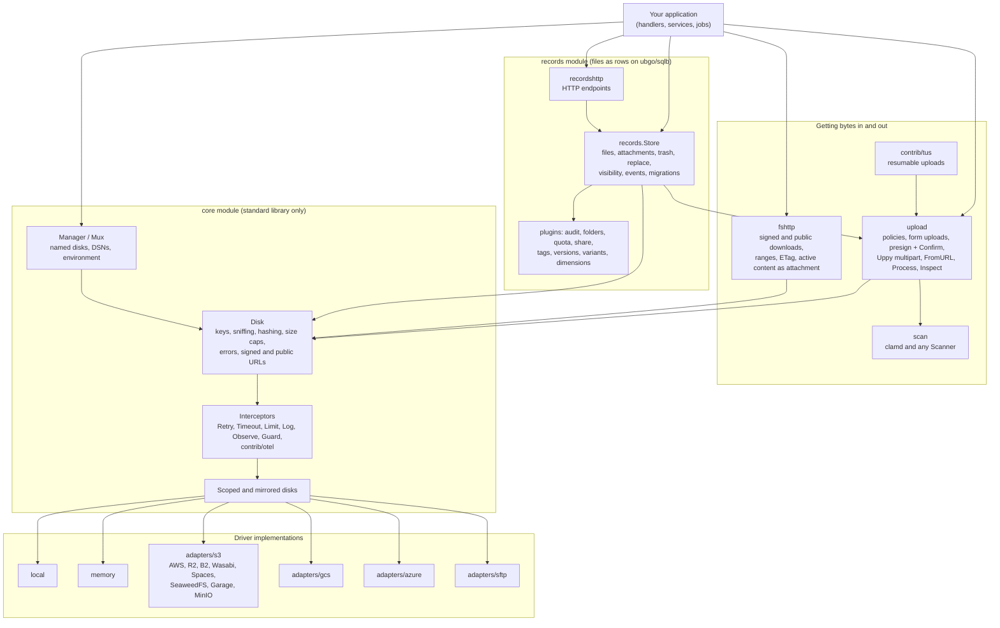
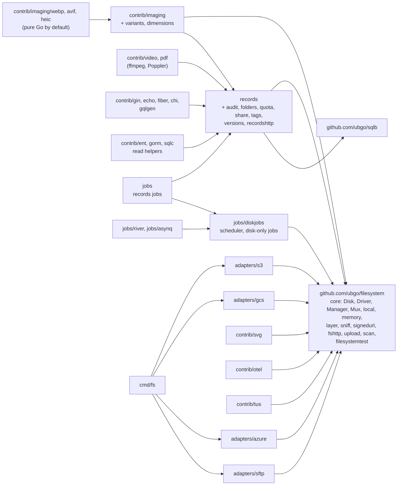
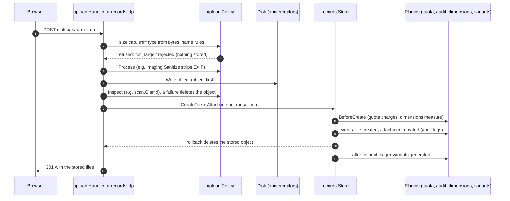
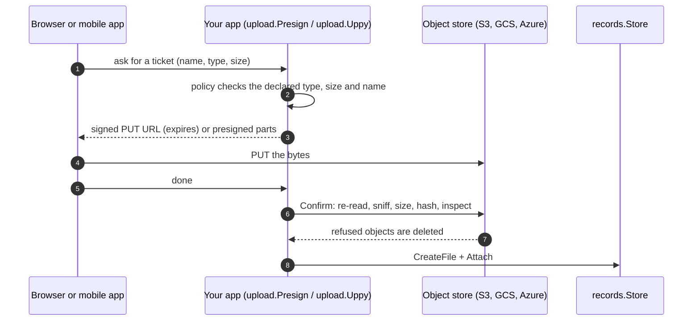
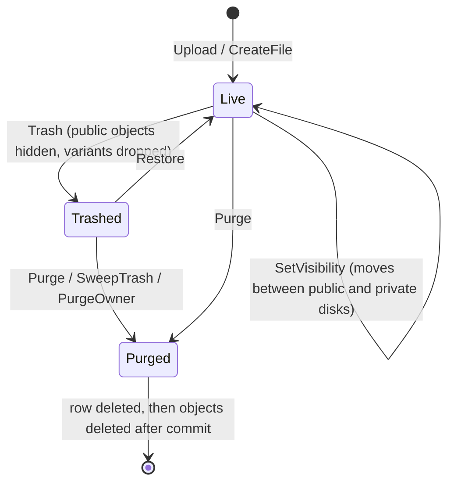

# ubgo/filesystem

<p align="center">
  <a href="LICENSE"></a>
  
  
</p>

One storage library for Go applications: a small portable API over local disk, memory and every S3-compatible store, with the parts every product builds on top of files already built: safe uploads, signed URLs, files as database rows attached to your models, and test fakes.

```go
mux := filesystem.NewMux()
mux.Register(s3.Scheme, s3.Opener)

disk, _ := mux.Open(ctx, "media", "s3://my-bucket?region=auto&endpoint=https://<account>.r2.cloudflarestorage.com")
entry, _ := disk.Write(ctx, "avatars/u1.png", body, filesystem.WriteOptions{})
link, _ := disk.SignedURL(ctx, "avatars/u1.png", filesystem.PresignOptions{Method: filesystem.MethodGet, Expires: 5 * time.Minute})
```

Switching from local disk in development to S3, R2 or SeaweedFS in production is a DSN change. Nothing else in the application moves. `mux.OpenManager(ctx, "STORAGE_", os.LookupEnv)` builds every disk from the environment (`STORAGE_DISKS=media,backups`, `STORAGE_MEDIA_DSN=…`, `STORAGE_DEFAULT_DISK=media`), and its errors name the variable, never the DSN, which usually holds credentials.

> **Status:** pre-release. The API may still change. Every library package is at 94 to 100% statement coverage ([COVERAGE.md](COVERAGE.md) lists every uncovered line and why). The S3 driver passes the conformance suite against a real SeaweedFS server, the Azure driver against Azurite, and the records module on SQLite, Postgres and MySQL, where every operation is also failed at each of its database steps in turn to prove it leaves nothing half done.

## Guides

The [guides](docs/README.md) start with a [learning path](docs/README.md#learning-path) of twelve ordered steps, a [start-from-your-goal](docs/README.md#start-from-your-goal) table and [choosing guides](docs/choosing/README.md) (which adapter, which upload method, how to serve files, whether you need records, which plugins for which app), and the [feature index](docs/reference/features.md) links every feature to the guide that teaches it and the example that runs it. They cover everything from a first disk to production: [install](docs/start/install.md), [your first app](docs/start/first-app.md), [production](docs/start/production.md), the [concepts](docs/README.md#concepts), every [backend](docs/adapters/README.md), [files as records](docs/records/README.md) and each [plugin](docs/README.md#plugins), [recipes](docs/recipes/README.md) for avatars, galleries, direct and resumable uploads, private downloads, tenants, account deletion and more, [integrations](docs/README.md#integrations) with net/http, chi, gin, echo, fiber and OpenTelemetry, [extending](docs/README.md#extending) and the [reference](docs/README.md#reference). Every Go snippet in them is copied from an example program in [examples/](examples) that the test suite compiles and runs.

## Why

Most Go products that store files end up writing their own storage layer: drivers, signed links, uploads, files as database rows, scanning, variants and cleanup jobs. This library is that layer as one set of packages, built to be imported rather than rewritten.

## How it fits together


The picture follows one upload from start to finish; the sections below zoom into each layer.

### The layers

An application holds `*filesystem.Disk` values, usually from a `Manager` it built by hand or from DSNs with the `Mux`. A Disk does the portable work (key cleaning, content sniffing, hashing, size caps, error codes, URLs) and runs every operation through its interceptors before it reaches the one `Driver` that talks to a backend. Everything else sits beside the Disk and uses it: `upload` decides what bytes may arrive, `fshttp` serves them, `scan` inspects them, and the `records` module remembers them as rows.



### The modules

Each box is a Go module, so an application downloads only what it imports. Arrows point at what a module requires. The core requires nothing outside the standard library, and a test fails the build if that changes.



### One operation through a Disk

Every Disk method runs the same way, whichever backend is behind it. Capabilities decide between the driver's native call, a portable fallback and `CodeUnsupported`, so an option is never silently dropped. Interceptors wrap the operation, not the driver, so they cannot hide a capability; the application chooses them and their order (the diagram shows the set from the [interceptors](#interceptors) example).

```mermaid
flowchart LR
    Call["disk.Write(ctx, key, body, opts)"] --> Clean["CleanKey<br/>traversal, control chars,<br/>length refused"]
    Clean --> Check["capability check<br/>native, fallback, or CodeUnsupported"]
    Check --> I1["Observe"] --> I2["Log"] --> I3["Retry<br/>(rewinds seekable bodies)"] --> I4["Timeout"] --> I5["Limit"]
    I5 --> Driver["Driver.Write"]
    Driver --> Count["count, hash, cap at MaxSize,<br/>sniff the content type"]
    Count --> Result["Entry or *Error with a Code<br/>(not_found, too_large, unavailable, …)"]
```



### An upload, end to end

A server-side upload from a form, through the records module. The object is written before its row and deleted again if the transaction rolls back, so bytes and rows never drift apart; plugins take part inside the same transaction.



Direct-to-bucket uploads skip the application for the bytes and check them afterwards:



### A file's life



### Where plugins plug in

A records plugin is any value with a `Name`; each capability is an optional interface the Store detects, so a plugin implements only what it needs.

| Interface | Called | Used by |
|---|---|---|
| `Migrator` | `Store.Migrate`, for the plugin's own tables | audit, folders, quota, share, tags, versions, variants |
| `FileHooks` | before a file row is inserted, after it, before a purge | quota, dimensions, share, tags, folders, versions, variants |
| `ReplaceHooks` | before new content replaces a file's | quota, dimensions |
| `Versioner` | when content is replaced: keep the old object or let it go | versions |
| `EventHooks` | after every change, inside its transaction | audit, variants, versions |
| `ObjectOwner` | when `SweepOrphans` asks which objects a plugin owns | versions, variants, video, pdf, ocr |
| `FileDiskMover` | when `MoveFile` moves a file to another disk, for the plugin's own objects | versions, variants, video, pdf, ocr |
| `DiskRenamer` | when `RenameDisk` renames a disk the plugin recorded | versions, variants, video, pdf, ocr |

## Packages

| Package | Module | What it does |
|---|---|---|
| `filesystem` | core | `Disk`, the `Driver` contract, capabilities, interceptors, `Manager`, scoped and mirrored disks, DSN `Mux`, typed errors, `Disk.FS` (a read-only `io/fs.FS` view), `ParseSize`, directories (`MakeDir`, `DirExists`), the abandoned-upload sweep and its dry run (`FindAbandoned`) |
| `filesystem/local` | core | Local directory driver: `os.Root` sandboxing, atomic and durable writes (`WithDurability`), visibility as file modes, multipart, real directories |
| `filesystem/memory` | core | In-memory driver with every capability that needs no network |
| `filesystem/layer` | core | Interceptors: `Retry`, `Timeout`, `Limit`, `Bandwidth`, `Hedge`, `Log` (slog), `Observe` (metrics hook), `Guard`, `Fault` (injected failures for tests) |
| `filesystem/sniff` | core | Content-type detection from bytes, with safe refinement by extension, and a `Detector` hook for formats it does not know (DICOM, STL, Parquet) that can never relabel a known type |
| `filesystem/scan` | core | Malware scanning: a `Scanner` contract, a clamd (ClamAV) client over TCP or a Unix socket, and `Inspect` to scan every upload before it is accepted |
| `filesystem/signedurl` | core | HMAC-signed URLs with key rotation, for disks whose backend cannot sign |
| `filesystem/fshttp` | core | `net/http` handlers for signed downloads and uploads (ranges, ETag, 304) and public files, Cache-Control by handler, `ServeEntry` (the same serve path for your own handler after its access check), `ServeZip` (many files streamed as one zip), `ClientMessage` (client-safe error text) |
| `filesystem/upload` | core | Upload policies, streaming form uploads, presigned uploads with server-side confirmation, Uppy S3 multipart endpoints, imports from a URL with an SSRF guard, sweeping of abandoned uploads, upload sessions (a server-issued token for one key or prefix, valid for a window), public direct uploads where the policy allows (`AllowPublic`), your own success envelope (`Respond`) |
| `filesystem/filesystemtest` | core | Conformance suite for drivers, and a `Fake` disk with assertions for application tests |
| `filesystem/adapters/s3` | own module | S3 and every S3-compatible store (R2, B2, Wasabi, Spaces, SeaweedFS, Garage, MinIO), on aws-sdk-go-v2 and its transfer manager; a customer's bucket through an assumed IAM role (`role_arn`), a KMS key per tenant (`Config.SSEKMSKeyFor`), prefix-scoped delegated credentials (`DelegatePrefix`) in any partition and on SSE-KMS buckets |
| `filesystem/adapters/gcs` | own module | Google Cloud Storage: V4 signed URLs, optional fine-grained ACLs, resumable uploads, a service account per disk (`credentials_file`, `credentials_env`), a KMS key or storage class per call (`WithRequestOptions`) |
| `filesystem/adapters/azure` | own module | Azure Blob Storage and Azurite: SAS URLs, block-based multipart, atomic commits, configurable block size and concurrency (`block_size`, `concurrency`) for blobs up to 190 TiB, an encryption scope, tier, tags or hold per call (`WithRequestOptions`), an endpoint behind a custom domain or Front Door (`AccountName`) |
| `filesystem/adapters/sftp` | own module | SFTP servers: atomic writes via posix-rename, conditional writes via hard links, known_hosts verification, ssh-agent and encrypted keys |
| `filesystem/adapters/ftp` | own module | FTP and FTPS servers (explicit or implicit, a private CA with `ca_file`): a connection pool and atomic writes through a staged upload and a rename |
| `filesystem/adapters/webdav` | own module | WebDAV servers over `net/http` (Nextcloud, ownCloud, many NAS): staged PUT then MOVE |
| `filesystem/adapters/sqlblob` | own module | Objects as rows of a table on SQLite, Postgres or MySQL through `ubgo/sqlb`: ranged reads, compare-and-swap, a size cap |
| `filesystem/adapters/gdrive`, `dropbox`, `onedrive` | own modules | Consumer drives over their REST APIs with the app's OAuth token; honest capabilities (no presign) |
| `filesystem/adapters/vercelblob`, `cloudinary` | own modules | Hosted storage APIs: Vercel Blob (compare-and-swap, batch delete) and Cloudinary raw resources (signed reads) |
| `filesystem/records` | own module | Files as rows (SQLite, Postgres, MySQL via `ubgo/sqlb`), polymorphic attachments, trash and purge, quarantine until scanned (`PassScan`, `FailScan`, `Scan`), migrations, plugins, your own table names (`WithTablePrefix`, `WithTableNames`) |
| `filesystem/records/audit` | records | Append-only log of every file and attachment change with its actor, written in the change's own transaction; per-file history, per-actor activity, retention, an HMAC hash chain with key rotation (`WithHashChainKeyring`), the request's source (`WithSource`) |
| `filesystem/records/folders` | records | Virtual folders per scope: create, rename, move (cycle- and depth-checked), delete when empty, file placement, paginated folder listings, case- or Unicode-insensitive sibling names (`WithNameKey`), one file shown in several folders (`WithShortcuts`) |
| `filesystem/records/quota` | records | Per-scope byte and file limits, charged race-free in the upload's transaction, plus counters of your own beside the scope's (an organisation's total, a content class) through `WithDimensions` |
| `filesystem/records/egress` | records | Bytes served per scope per UTC day (or your own buckets, hourly or in each tenant's time zone, with `WithBucket`), optionally broken down per share link or other subject (`WithPerSubject`), reported as `egress.daily_total` events with stable IDs for billing |
| `filesystem/records/webhooks` | records | Outbound webhooks: an outbox written in the change's own transaction, Standard Webhooks HMAC signatures (or your own `Signer`), secret rotation, global endpoints for every scope, your own payload shape, retries with backoff, an SSRF guard |
| `filesystem/records/recordshttp` | records | HTTP endpoints for attachments: upload and attach (all or nothing), list, reorder, detach, redirect to a file, replace its content, trash; authorization through two required hooks; the disk fixed, chosen per request (`DiskFor`) or by visibility; your own success envelope (`Respond`) |
| `filesystem/records/tags` | records | Tags on files: normalized labels, files by tag (all of several), tag counts, rename and delete across a scope |
| `filesystem/records/versions` | records | Previous contents of replaced files: history per file with a cap or a per-file policy (`WithKeepFunc`, `Trim`), restore (itself undoable), delete |
| `filesystem/records/share` | records | Expiring, download-limited share links with hashed tokens and a redirecting handler; your own access check, delivery page, error pages, success envelope (`WithRespond`) and per-request upload policy |
| `filesystem/records/acl` | records | Read, write and admin grants (or your own levels, `WithLevels`) on files, folders and your own containers (`WithContainers`), inherited down a folder tree, optionally expiring, deny grants (`WithDeny`), with an authorizer for recordshttp |
| `filesystem/records/uploadsessions` | records | Upload sessions kept in the database (only a hash of each token's secret), so they survive a restart and are shared by every instance |
| `filesystem/records/locks` | records | Check-out locks with expiry: only the holder may replace, trash or purge a locked file until it unlocks, the lock expires or it is broken; WebDAV-style lock tokens (`TokenHolder`); shared locks with several holders (`WithSharedLocks`) |
| `filesystem/contrib/imaging` | own module | Safe pure-Go resizing (pixel-bomb guard, EXIF orientation, re-encoding), fit, fill (with gravity), pad and user-chosen crops, header-only `Probe`, `Sanitize` (an upload processor that strips EXIF and GPS), and records plugins for named, cached image variants (generated on first request, or eagerly after an upload commits, with 2x/3x densities and their `srcset`) and for stored image dimensions; variants on any disk (`WithLocation`) |
| `filesystem/contrib/otel` | own module | OpenTelemetry tracing and metrics interceptors |
| `filesystem/contrib/keynorm` | own module | Unicode NFC key normalisation for `WithKeyNormalizer`, so composed and decomposed spellings name one object |
| `filesystem/contrib/imaging/placeholder` | contrib/imaging | Generated fallback avatars: initials or an identicon, with a cache-friendly handler |
| `filesystem/contrib/imaging/webp`, `avif`, `heic` | own modules | WebP and AVIF encoding and decoding, HEIC decoding, behind the imaging processor; pure Go by default, a system library when one is installed (`-tags nodynamic` forces pure Go) |
| `filesystem/contrib/imaging/icc` | own module | ICC colour profiles: parsing and conversion to sRGB, standard library only |
| `filesystem/contrib/video` | own module | Video metadata, poster frames and metadata stripping through ffprobe and ffmpeg, plus transcoding to a browser-ready MP4 and storyboards with WebVTT, as upload hooks and a records plugin; posters on any disk (`WithLocation`); an HLS ladder for adaptive streaming (`Tool.HLS`) |
| `filesystem/contrib/audio` | own module | Audio metadata, waveforms and Opus or AAC transcoding through ffprobe and ffmpeg, as upload hooks and a records plugin |
| `filesystem/contrib/videoplatform` | own module | Hand streaming to Mux or Cloudflare Stream: a records plugin that publishes a video, tracks its state from signed webhooks and deletes the platform copy after the file goes |
| `filesystem/contrib/pdf` | own module | PDF page count, page size and first-page previews through Poppler, as upload hooks and a records plugin; previews and text on any disk (`WithLocation`) |
| `filesystem/contrib/office`, `ocr`, `vision` | own modules | Office documents to PDF through sandboxed LibreOffice, OCR through Tesseract, and auto-tagging through a `Labeler` (Google Cloud Vision) |
| `filesystem/contrib/pickers` | own module | Imports a file picked in Google Drive, Dropbox or OneDrive through `upload.Receive`, the token sent only to the source's own hosts |
| `filesystem/contrib/svg` | own module | An allow-list SVG sanitiser and an upload policy that accepts SVG safely |
| `filesystem/contrib/svg/raster` | own module | SVG rasterising to an image, bounded in size and concurrent renders |
| `filesystem/contrib/archive` | own module | Zip and tar listing and extraction: limits enforced while decompressing, every name cleaned, links refused, an upload inspector that denies executables |
| `filesystem/contrib/crypt` | own module | A wrapper disk that encrypts at rest: chunked AES-GCM with ranged reads, data keys wrapped by a keyring or KMS, per-tenant keys and rotation |
| `filesystem/contrib/gin`, `echo`, `fiber`, `chi` | own modules | Framework adapters: mount the handlers, actor and tenant middleware, client-safe errors, zip downloads |
| `filesystem/contrib/gqlgen` | own module | GraphQL uploads: the `Upload` scalar through an upload policy, records, a safe error presenter |
| `filesystem/contrib/ent`, `gorm`, `sqlc` | own modules | Read helpers over the records tables for apps on ent, GORM or sqlc; writes stay with the Store; each follows a Store's table names (ent `Names`, `fsgorm.NewNamer`, `sqlc.FSWith`) |
| `filesystem/jobs` | own module | The maintenance jobs (sweeps, recounts, prunes, promote) and an in-process scheduler |
| `filesystem/jobs/diskjobs` | own module | The jobs that need no database (`UploadSweep`, `SweepAbandoned`, `Promote`) and the scheduler, importing the core module only |
| `filesystem/jobs/river`, `jobs/asynq` | own modules | The same jobs on River (Postgres) or Asynq (Redis), for several instances |
| `filesystem/contrib/tus` | own module | Resumable uploads (tus protocol) by embedding tusd, promoted through the same upload policy, optionally narrowed by an upload session (`Config.Resolve`); a shared session store and locker for several instances (`Config.Store`, `Config.Locker`), CORS policy (`Config.Cors`) |
| `filesystem/contrib/cloudfront` | own module | CloudFront signed URLs and signed cookies as a `filesystem.URLSigner`, keys redacted; signs downloads even on an S3 disk that presigns its own |
| `filesystem/contrib/cloudflare` | own module | Cloudflare token-authentication signed URLs, standard library only |
| `filesystem/contrib/remote` | own module | Remote media: link previews (with oEmbed from providers you allow), an HMAC-signed image proxy and a capped media cache, every fetch through the SSRF guard |
| `filesystem/contrib/notify` (+ `eventgrid`, `sqs`, `pubsub`) | own modules | Bucket events turned into callbacks: Azure Event Grid (authenticated handshake), S3/R2 through SQS, GCS through Pub/Sub pull; a bucket allowlist on each |
| `filesystem/cmd/fs` | own module | A command-line tool: ls, stat, cat, put, cp and mv across backends, rm, url, check, with `-json` |

The core module depends on the standard library only, and a test enforces this. Anything that needs a third-party library is its own module, so you download only what you import.

## Capabilities, never lies

Some backends can do things others cannot: presigned URLs, server-side copy, per-object ACLs, multipart uploads, stored metadata, conditional writes. A driver declares what it supports in one `Capabilities` struct. `NewDisk` refuses a driver that declares an interface it doesn't implement, and the conformance suite exercises every declared capability against the real backend. A `Disk` method whose capability is missing either falls back to a portable implementation (Copy, Move, DeletePrefix) or returns an error with `CodeUnsupported`. It never silently drops your option.

| Capability | local | memory | s3 | gcs | azure | sftp |
|---|---|---|---|---|---|---|
| Server-side copy | streams | yes | yes | yes | yes | streams |
| Atomic move | yes | yes | copy + delete | copy + delete | copy + delete | yes |
| Per-object visibility | file mode | yes | `acl=true` (AWS) | `acl=true` | no (container level) | file mode |
| Bulk prefix delete | yes | yes | yes | list + delete | list + delete | yes |
| Batch delete of keys | one by one | yes | 1,000 per request | one by one | one by one | one by one |
| Signed URLs | via `signedurl` + `fshttp` | via `signedurl` | SigV4 | V4 with a key | SAS with a shared key | via `signedurl` + `fshttp` |
| Multipart (server) | yes | yes | yes | no (resumable in Write) | yes | no |
| Presigned parts (browser) | no | no | yes | no | no | no |
| Sweep of abandoned uploads (`SweepAbandoned`) | yes | yes | opt-in (`sweep_uploads=true`); a lifecycle rule is preferred | no (sessions expire) | yes | yes |
| Its dry run (`FindAbandoned`) | yes | yes | with `sweep_uploads=true` | no | yes | yes |
| Real directories (`MakeDir`, `DirExists`) | yes | yes | no (a directory exists while a key is under it) | no | no | yes |
| Stored metadata / content type | no / no | yes / yes | yes / yes | yes / yes | yes / yes | no / no |
| Stored HTTP headers (Cache-Control, Content-Disposition, Content-Encoding) | no | yes | yes | yes | yes | no |
| Presigned PUT pins stored headers (`PresignHeaders`) | no (stores no headers) | via `signedurl` + `fshttp` | yes (`presign_headers=true`, the default) | yes, with a signing account | no (SAS cannot pin them) | no |
| Presigned upload pins visibility (`PresignVisibility`) | no | no | `acl=true` with signed headers checked | `acl=true`, with a signing account | no | no |
| Presigned POST form uploads (`PresignPost`) | no | no | yes | yes, with a signing key or IAM | no | no |
| Backend-verified SHA-256 (`ChecksumSHA256`; the Disk verifies on every backend) | no | no | yes | no | no | no |
| Conditional write | yes | yes | `conditional_write=true` | yes | yes | with hard links |

## Interceptors

Retry, timeouts, concurrency limits, logging, metrics and policy checks run around every operation without wrapping the driver, so they can never hide a capability. This is the usual failure of Go decorators, and this design avoids it.

```go
disk, _ := filesystem.NewDisk("media", drv, filesystem.WithInterceptors(
	layer.Observe(recordMetrics),
	layer.Log(logger),
	layer.Retry(layer.RetryOptions{}),
	layer.Timeout(10*time.Second),
	layer.Limit(32),
))
```

A retried write rewinds its body when the body is seekable, and is never retried when it is a one-shot stream.

## Uploads

```go
policy := upload.Policy{MaxSize: 10 << 20, Allowed: []string{"image/*", "application/pdf"}}
http.Handle("/upload", upload.Handler(disk, policy, upload.HandlerOptions{MaxFiles: 5}))
```

The type is detected from the content, never taken from the client's header or file name. HTML, SVG, XML, executables and script file names (`.php`, also hidden as `photo.php.jpg`) are refused unless explicitly allowed, and fshttp and signed downloads serve active content as an attachment, never inline. Size is counted while streaming, and nothing larger than the limit is ever stored. A request stores all its files or none of them; with `HandlerOptions{Partial: true}` a bulk upload stores every file it can and lists the others, each with its own error code. Direct-to-bucket uploads use `upload.Presign` followed by `upload.Confirm`, which re-checks the stored bytes. Browser multipart uploads use `upload.Uppy`, which speaks the protocol of Uppy's AWS S3 plugin. `Policy.Process` transforms each file before it is stored; `imaging.Sanitize` re-encodes photos so the GPS position, camera details and anything smuggled after the image never reach storage. `Policy.Inspect` runs on every stored upload before success is reported, and its error deletes the file: `scan.Inspect(scan.Clamd{Network: "tcp", Address: "127.0.0.1:3310"})` scans every upload path with ClamAV, failing closed when the scanner is down. `Policy.Extensions` limits file-name extensions and `Policy.MatchExtension` refuses a file whose name claims another type than its bytes (a PNG named `invoice.pdf`); `upload.Inspectors` chains several inspections. Imports from a URL use `upload.FromURL`, which goes through the same policy and refuses any connection to a non-public address (loopback, private networks, cloud metadata) at dial time, so DNS rebinding and redirects cannot reach inside.

## Files as records

```go
store, _ := records.New(db, sqlb.PostgresDialect{}, manager, records.WithOwnerTypes("user", "post"))
store.Migrate(ctx)

f, _ := store.Upload(ctx, tenantID, "media", body, filename, policy)
store.Attach(ctx, tenantID, f.ID, records.Owner{Type: "post", ID: postID}, "gallery")
gallery, _ := store.Attachments(ctx, tenantID, records.Owner{Type: "post", ID: postID}, "gallery")
```

`records.WithSingleRoles("avatar")` lets the database hold one file per owner in a role, even under concurrent requests; `store.SetAttachment` replaces it and keeps, trashes or purges the previous file, and `store.PurgeOwner` deletes what a deleted user or post leaves behind (a file another owner still uses is only detached). `records.WithVisibilityDisks("cdn", "vault")` keeps public files on a public bucket behind a CDN and private ones on another, and `store.SetVisibility` moves a file between them with its versions, regenerating its thumbnails, so nothing of a file made private stays public. `records.WithActor(ctx, userID)`, set once in the authentication middleware, is recorded as each file's `UploadedBy` and logged by the `audit` plugin. `store.Replace` gives a file new content and keeps its ID, so its attachments, folder, tags and links stay; the old object is deleted after the commit unless the `versions` plugin keeps it, quota charges the difference, and image variants are regenerated. Bytes and rows stay consistent without a shared transaction. Objects are written before rows and deleted only after the row deletion commits. A rolled-back upload deletes its object. Plugins add their own tables (with migrations) and lifecycle hooks. An `EventHooks` plugin hears of every change (created, trashed, restored, purged, attached, detached, reordered, released from quarantine) inside the change's transaction, which is how `audit` never logs a change that rolled back; search indexing and webhooks plug in the same way.

`recordshttp.Handler` serves these operations over `net/http` for any router. The library knows nothing about users: `Scope` maps a request to its tenant and `Authorize` decides each action, and both are required.

```go
h, _ := recordshttp.Handler(recordshttp.Config{
	Store: store, Disk: "media", Policy: policy,
	Scope:     func(r *http.Request) (string, error) { return tenantOf(r) },
	Authorize: func(r *http.Request, a recordshttp.Action, t recordshttp.Target) error { return can(r, a, t) },
})
mux.Handle("/media/", http.StripPrefix("/media", h))
```

## Examples

`examples/drive` is a team drive in about 300 lines: workspaces with a quota, files attached to projects, folders, tags, version history with restore, expiring share links, an activity feed and image dimensions, all plugins of one Store, with a test that walks a file through its whole life over HTTP. `examples/mediaserver` is the smaller avatar flow written by hand, and `examples/basics` the Disk API alone.

## Testing your code

```go
disk := filesystemtest.NewFake(t, "media")
service := NewAvatarService(disk)
service.Save(ctx, userID, image)
disk.AssertExists("avatars/" + userID + ".png")
```

A driver you write is checked with `filesystemtest.Run(t, newDisk)`. This is the same suite the built-in drivers pass, and its own tests prove that every case catches the bug it is meant to catch.

## Development

| Command | What it does |
|---|---|
| `task check` | gofmt, vet (host plus Linux, Windows and FreeBSD), every module's tests, the Markdown wrap check |
| `task test:rustfs` | The S3 conformance suite against RustFS |
| `task test:s3` | The S3 conformance suite against SeaweedFS (`prune_prefixes=true`) |
| `task test:azure` | The Azure driver's tests against Azurite |
| `task test:clamav` | The scan package against a real clamd |
| `task test:engines` | The records suite and the imaging plugins on SQLite, Postgres and MySQL |

Each Docker-backed task starts a throwaway container from `compose.yml`, runs, and removes the container and its data afterwards, even when a test fails; Postgres is the host's.
| `task cover`, `task cover:records` | Coverage per module, and records merged across the three engines |

## License

Apache-2.0. See [LICENSE](LICENSE) and [NOTICE](NOTICE). Contributions: [CONTRIBUTING.md](CONTRIBUTING.md); security reports: [SECURITY.md](SECURITY.md); changes: [CHANGELOG.md](CHANGELOG.md).
