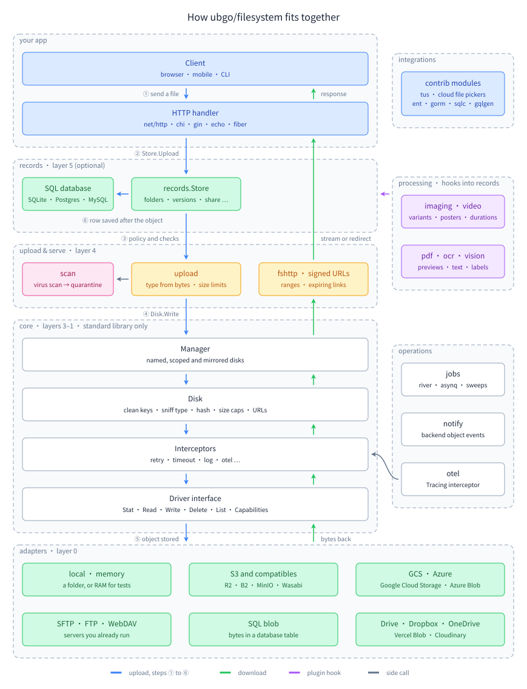

# filesystem guides

Everything about using and extending `github.com/ubgo/filesystem`, the storage library you import into a Go app. New here? Follow the learning path from step 1. Building one product feature? Jump in by goal. Unsure which adapter, upload method or serving path fits? Read the choosing guides first.

Every Go snippet in these guides is copied by [docsync](https://github.com/ubgo/docsync) from a program in [examples/](../examples) that the test suite compiles and runs, and every HTTP transcript comes from a real run, so what you read is what the code does today.

## Learning path

Twelve steps, from storing your first file to a multi-tenant SaaS with records, image variants, quarantine scanning, signed URLs, jobs and observability. Each step builds on the ones before it, and each has a guide and a program you can run with `go run ./<folder>` from the `examples` directory.

| # | You learn | Guide | Run it |
|---|---|---|---|
| 1 | Open a disk on a local directory, write and read a file, then run the same code on S3 by changing one DSN | [Install](start/install.md) | [start-install](../examples/start-install) |
| 2 | The `Disk` API (write, read, stat, list, copy, move, delete), how keys are cleaned, and the error codes every backend shares | [Disks and drivers](concepts/disks-and-drivers.md), [Keys](concepts/keys.md), [Errors](concepts/errors.md) | [concepts-disks](../examples/concepts-disks), [concepts-keys](../examples/concepts-keys), [concepts-errors](../examples/concepts-errors) |
| 3 | Test code that stores files: the `Fake` disk, the memory driver, records on SQLite, injected failures | [Test your app](start/testing.md) | [start-testing](../examples/start-testing) |
| 4 | Accept uploads safely: a `Policy`, types detected from the bytes, sizes capped while streaming, refused files never kept; then prove a stored file is the file that was sent | [Uploads](concepts/uploads.md), [Integrity](concepts/integrity.md) | [concepts-uploads](../examples/concepts-uploads), [concepts-integrity](../examples/concepts-integrity) |
| 5 | Serve files: signed links that expire, public URLs, `fshttp`, ranges and active content as downloads | [Serving files](concepts/serving-files.md) | [concepts-serving](../examples/concepts-serving) |
| 6 | Files as rows in your database, attached to your models, in a complete HTTP app with trash and restore | [Your first app](start/first-app.md), then [Records](records/README.md) and [Attachments](records/attachments.md) | [quickstart](../examples/quickstart), [records-attachments](../examples/records-attachments) |
| 7 | Thumbnails and resized copies of every image, generated eagerly or on first request, and the transforms behind them | [Variants](plugins/variants.md), [Image transforms](plugins/image-transforms.md) | [records-variants](../examples/records-variants), [imaging-transforms](../examples/imaging-transforms) |
| 8 | Uploads from real clients: direct to the bucket, chunked, resumable, folders, retries without duplicates | [Upload clients](concepts/upload-clients.md), [Resumable uploads](recipes/resumable-uploads.md) | [concepts-upload-clients](../examples/concepts-upload-clients), [recipe-resumable-uploads](../examples/recipe-resumable-uploads) |
| 9 | Keep a file in quarantine until a malware scan passes, and report processing status to clients | [Processing status and quarantine](records/processing-status.md), [Virus scanning](recipes/virus-scanning.md) | [records-status](../examples/records-status), [recipe-virus-scanning](../examples/recipe-virus-scanning) |
| 10 | Tenants: a scoped disk per tenant, the records scope, and storage quotas per plan | [Multi-tenancy](concepts/multi-tenancy.md), [Quota](plugins/quota.md) | [concepts-tenancy](../examples/concepts-tenancy), [records-quota](../examples/records-quota) |
| 11 | Retry, timeouts, limits, logs, metrics and traces around every operation; the sweeps and recounts every deployment schedules | [Interceptors](concepts/interceptors.md), [OpenTelemetry](integrations/otel.md), [Maintenance jobs](concepts/maintenance-jobs.md) | [concepts-interceptors](../examples/concepts-interceptors), [integrations-otel](../examples/integrations-otel), [concepts-jobs](../examples/concepts-jobs) |
| 12 | Put it together: a multi-tenant SaaS wired from the environment, with signing-key rotation, migrations in deploys, health checks and several instances | [Going to production](start/production.md), [SaaS tenants](recipes/saas-tenants.md) | [start-production](../examples/start-production), [recipe-saas-tenants](../examples/recipe-saas-tenants) |

## Start from your goal

| I need | Start with | Then |
|---|---|---|
| Profile pictures | [Avatars](recipes/avatars.md) | [Variants](plugins/variants.md), [Image transforms](plugins/image-transforms.md) |
| Product photos in a gallery | [Product images](recipes/product-images.md) | [Attachments](records/attachments.md) |
| A banner or cover image | [Cover images](recipes/cover-images.md) | [Variants](plugins/variants.md) |
| Uploads from an iOS or Android app that survive a dropped connection | [Mobile uploads](recipes/mobile-uploads.md) | [Resumable uploads](recipes/resumable-uploads.md), [Upload sessions](plugins/upload-sessions.md) |
| Browsers uploading straight to the bucket | [Browser direct uploads](recipes/browser-direct-uploads.md) | [Which upload method](choosing/which-upload-method.md) |
| To store files for tenants (workspaces, organisations) | [SaaS tenants](recipes/saas-tenants.md) | [Multi-tenancy](concepts/multi-tenancy.md), [Quota](plugins/quota.md), [Tenant branding](recipes/tenant-branding.md) |
| A Drive-like file manager | [Team drive](recipes/team-drive.md) | [Folders](plugins/folders.md), [Share](plugins/share.md), [Permissions](plugins/acl.md), [Versions](plugins/versions.md) |
| Files in chat messages | [Chat attachments](recipes/chat-attachments.md) | [Serving files](concepts/serving-files.md) |
| Downloads only the owner may fetch | [Private downloads](recipes/private-downloads.md) | [Serving files](choosing/serving-files.md) |
| Public assets behind a CDN | [Public CDN](recipes/public-cdn.md) | [Public and private files](concepts/public-and-private.md) |
| Malware scanning before anyone downloads a file | [Virus scanning](recipes/virus-scanning.md) | [Processing status and quarantine](records/processing-status.md) |
| A CSV or bulk import that runs in the background | [Bulk import](recipes/bulk-import.md) | [Maintenance jobs](concepts/maintenance-jobs.md) |
| To mail stored files | [Email attachments](recipes/email-attachments.md) | [Exports](recipes/exports.md) |
| To move my files to another backend | [Move to S3](recipes/move-to-s3.md) | [Maintenance](maintenance/README.md#moving-every-file-to-another-disk) |
| To save files into the customer's own Google Drive, Dropbox or OneDrive | [gdrive](adapters/gdrive.md), [dropbox](adapters/dropbox.md), [onedrive](adapters/onedrive.md) | [Which adapter](choosing/which-adapter.md) |
| To read file rows from ent, GORM or sqlc | [ent](integrations/ent.md), [GORM](integrations/gorm.md), [sqlc](integrations/sqlc.md) | [Do I need records?](choosing/do-i-need-records.md) |
| To confirm direct uploads the moment the bucket stores them | [Maintenance, bucket notifications](maintenance/README.md#bucket-notifications) | [Which upload method](choosing/which-upload-method.md) |
| A backend the library does not ship | [Write a driver](extending/write-a-driver.md) | [Test your app](start/testing.md#step-7--the-conformance-suite-for-a-driver-of-your-own) |

## Choosing

Short decision guides, each with a table, an "if this, then that" flow and links to the guide and example for every option. The index is [choosing](choosing/README.md).

| Question | Guide |
|---|---|
| Which backend: local, S3 or a compatible store, GCS, Azure, SFTP, a SQL table, a user's drive | [Which adapter](choosing/which-adapter.md) |
| How bytes arrive: form post, presigned PUT or POST, multipart, tus, upload sessions, chunks, data URIs | [Which upload method](choosing/which-upload-method.md) |
| How bytes leave: through your server, signed URLs, public URLs, a signing CDN, the variants handler | [Serving files](choosing/serving-files.md) |
| Whether to keep files as rows in your database, and which records plugins to install | [Do I need records?](choosing/do-i-need-records.md) |
| The adapters, plugins and recipes to start from for SaaS, social, e-commerce, document management, media and chat | [Plugins by app](choosing/plugins-by-app.md) |

## Getting started

| Guide | What you get |
|---|---|
| [Install](start/install.md) | The modules to `go get`, a first disk on local storage, the same code on S3 |
| [Your first app](start/first-app.md) | From an empty folder to an HTTP server that accepts photo uploads, records and attaches them, serves them through signed links and deletes them |
| [Going to production](start/production.md) | Backends from the environment, secrets, interceptors, migrations in deploys, scheduled sweeps, quotas, scanning, health checks, several instances |
| [Test your app](start/testing.md) | The `Fake` disk and its assertions, the memory driver, records on SQLite, injecting failures |

## Concepts

| Page | Explains |
|---|---|
| [Disks and drivers](concepts/disks-and-drivers.md) | The `Disk` you hold, the `Driver` a backend implements, and every operation between them |
| [Keys](concepts/keys.md) | What a key may contain, how it is cleaned, and why traversal is refused |
| [Capabilities](concepts/capabilities.md) | What each backend can do, the portable fallbacks, and `CodeUnsupported` |
| [Errors](concepts/errors.md) | Error codes, sentinels, batch errors, and their HTTP statuses |
| [Interceptors](concepts/interceptors.md) | Retry, timeout, concurrency limits, logging, metrics and policy checks around every operation |
| [Composing disks](concepts/composing-disks.md) | Route by prefix, read failover, overlays, a read cache, and the bandwidth, fault, hedge and batch layers |
| [Configuration](concepts/configuration.md) | The `Manager`, DSNs, the `Mux`, and every disk from the environment |
| [Serving files](concepts/serving-files.md) | Signed URLs, public URLs, `fshttp`, ranges, caching headers, and active content served as downloads |
| [Uploads](concepts/uploads.md) | Policies, form uploads, upload sessions, presigned uploads, Uppy multipart, imports from a URL, processing and inspection, sweeping abandoned uploads and its dry run |
| [Upload clients](concepts/upload-clients.md) | Chunked uploads (Dropzone, FilePond, resumable.js), progress, folder uploads, retries under an `Idempotency-Key`, and the JSON every endpoint answers with |
| [Integrity](concepts/integrity.md) | The SHA-256 of every write, declared digests and sizes, ETags, backend checksums, content-addressed keys and scrubbing |
| [Security](concepts/security.md) | Every default the library enforces, and what your app must still do |
| [Consistency](concepts/consistency.md) | How objects and rows stay in step without a shared transaction, and the sweeps that clean up |
| [Multi-tenancy](concepts/multi-tenancy.md) | Scopes, scoped disks, per-tenant quotas |
| [Public and private files](concepts/public-and-private.md) | Visibility per object, per disk, and public and private buckets |
| [Maintenance jobs](concepts/maintenance-jobs.md) | The sweeps and recounts every deployment runs on a schedule, an in-process scheduler, and River or Asynq for several instances |
| [Maintenance](maintenance/README.md) | Dry runs before any sweep deletes, integrity scrubbing, moving every file to a new disk without downtime, syncing one disk to another, exporting a user's files, and bucket events from S3, GCS and Azure |

## Backends

| Adapter | Guide |
|---|---|
| Choosing a backend: every capability compared | [adapters](adapters/README.md) |
| Local directory | [local](adapters/local.md) |
| In memory, for tests and caches | [memory](adapters/memory.md) |
| Amazon S3 | [s3](adapters/s3.md) |
| Cloudflare R2, Backblaze B2, Wasabi, DigitalOcean Spaces, SeaweedFS, Garage, MinIO | [S3-compatible stores](adapters/s3-compatible.md) |
| Google Cloud Storage | [gcs](adapters/gcs.md) |
| Azure Blob Storage | [azure](adapters/azure.md) |
| SFTP servers | [sftp](adapters/sftp.md) |
| FTP and FTPS servers | [ftp](adapters/ftp.md) |
| WebDAV servers (Nextcloud, ownCloud, many NAS) | [webdav](adapters/webdav.md) |
| A table in your SQL database (SQLite, Postgres, MySQL) | [sqlblob](adapters/sqlblob.md) |
| Google Drive, Dropbox and OneDrive with the user's OAuth token | [gdrive](adapters/gdrive.md), [dropbox](adapters/dropbox.md), [onedrive](adapters/onedrive.md) |
| Vercel Blob and Cloudinary | [vercelblob](adapters/vercelblob.md), [cloudinary](adapters/cloudinary.md) |
| Supabase Storage through the S3 driver | [supabase](adapters/supabase.md) |

## Files as records

| Guide | Covers |
|---|---|
| [Records overview](records/README.md) | Files as rows in your database, attached to your models |
| [Files](records/files.md) | Recording, uploading, listing with pagination and filters, links |
| [Attachments](records/attachments.md) | Roles, ordering, single-file roles such as avatars, replacing an attachment |
| [Lifecycle](records/lifecycle.md) | Trash, restore, purge, purging everything an owner leaves behind, sweeping the trash |
| [Replace and visibility](records/replace-and-visibility.md) | New content for the same file, and moving files between public and private disks |
| [Processing status and quarantine](records/processing-status.md) | Where a file's processing stands, polling it from a client, and quarantine until a scan passes (`PassScan`, `FailScan`, `Scan`) |
| [Events and hooks](records/events-and-hooks.md) | Every event and hook a plugin can use |
| [Migrations](records/migrations.md) | Creating and upgrading the tables on SQLite, Postgres and MySQL |
| [HTTP endpoints](records/http-endpoints.md) | Upload, list, reorder, detach, download, replace and trash over HTTP |

## Plugins

| Plugin | Guide |
|---|---|
| Activity feed, access log, tamper-evident audit trail and change feed | [audit](plugins/audit.md) |
| Virtual folders | [folders](plugins/folders.md) |
| Storage limits per tenant, reservations for uploads in flight, usage events | [quota](plugins/quota.md) |
| Bytes served per tenant per day, for billing | [egress](plugins/egress.md) |
| Signed outbound webhooks with retries | [webhooks](plugins/webhooks.md) |
| Expiring share links, shared folders, file requests | [share](plugins/share.md) |
| Permissions on files and folders | [acl](plugins/acl.md) |
| Check-out locks | [locks](plugins/locks.md) |
| Tags and tag counts | [tags](plugins/tags.md) |
| Version history and restore | [versions](plugins/versions.md) |
| Upload sessions kept in the database, shared by every instance | [upload sessions](plugins/upload-sessions.md) (`records/uploadsessions`) |
| Image variants (thumbnails) | [variants](plugins/variants.md) |
| Image width and height | [dimensions](plugins/dimensions.md) |
| Resize modes, EXIF orientation, smart crop, watermarks, animated GIFs, placeholder colours, decode limits, golden tests | [image transforms](plugins/image-transforms.md) |
| Image decoding and encoding backends, extra formats | [image processing](plugins/image-processing.md) |
| Video metadata, poster frames, metadata stripping, transcoding, storyboards and streaming through Mux or Cloudflare Stream (ffmpeg, ffprobe) | [video](plugins/video.md) |
| Audio metadata, waveforms and transcoding (ffmpeg, ffprobe) | [audio](plugins/audio.md) |
| PDF page count, page size, metadata, text extraction and first-page previews (Poppler) | [pdf](plugins/pdf.md) |
| Office documents (DOCX, XLSX, PPTX) to PDF through LibreOffice, sandboxed | [office](plugins/office.md) |
| Text from scanned images and PDFs (Tesseract OCR) | [ocr](plugins/ocr.md) |
| Auto-tagging images with labels (Google Cloud Vision, behind a `Labeler`) | [vision](plugins/vision.md) |
| Importing a file picked in Google Drive, Dropbox or OneDrive through an upload policy | [pickers](plugins/pickers.md) |
| Accepting SVG safely: a sanitiser that removes scripts, event handlers and external references | [svg](plugins/svg.md) |
| Archive listing and extraction with bomb limits and zip-slip protection | [archive](plugins/archive.md) |
| Client-side encryption at rest with per-tenant keys and rotation | [crypt](plugins/crypt.md) |
| Link previews, a signed image proxy and a remote media cache | [remote](plugins/remote.md) |

## Recipes

[Recipes](recipes/README.md): complete solutions to common product needs, each backed by a tested program.

| Need | Recipe |
|---|---|
| Profile pictures | [avatars](recipes/avatars.md) |
| Product galleries | [product images](recipes/product-images.md) |
| Banners on profile, channel and event pages | [cover images](recipes/cover-images.md) |
| A logo, favicon and email header per tenant | [tenant branding](recipes/tenant-branding.md) |
| Files in messages | [chat attachments](recipes/chat-attachments.md) |
| A Drive-like file manager | [team drive](recipes/team-drive.md) |
| Uploads straight from the browser to the bucket | [browser direct uploads](recipes/browser-direct-uploads.md) |
| Large uploads that survive a dropped connection | [resumable uploads](recipes/resumable-uploads.md) |
| iOS and Android uploads | [mobile uploads](recipes/mobile-uploads.md) |
| Importing an image from a link | [import from URL](recipes/import-from-url.md) |
| Malware scanning | [virus scanning](recipes/virus-scanning.md) |
| Removing GPS and camera data from photos | [strip photo metadata](recipes/strip-photo-metadata.md) |
| Downloads only the owner may fetch | [private downloads](recipes/private-downloads.md) |
| Public assets behind a CDN | [public CDN](recipes/public-cdn.md) |
| One deployment, many customers | [SaaS tenants](recipes/saas-tenants.md) |
| Closing an account | [account deletion](recipes/account-deletion.md) |
| Copies in a second store | [backups and mirrors](recipes/backups-and-mirrors.md) |
| Moving existing files to S3 | [move to S3](recipes/move-to-s3.md) |
| Generated reports and exports | [exports](recipes/exports.md) |
| A CSV import accepted now and processed in a job | [bulk import](recipes/bulk-import.md) |
| Stored files attached to an email, or linked when too large | [email attachments](recipes/email-attachments.md) |

## Integrations

| Where | Guide |
|---|---|
| net/http, chi, gorilla | [net/http](integrations/net-http.md) |
| gin | [gin](integrations/gin.md) |
| echo | [echo](integrations/echo.md) |
| fiber | [fiber](integrations/fiber.md) |
| Ready-made adapters for gin, echo, fiber and chi (mount, actor and scope middleware, safe errors, zip downloads) | [framework adapters](integrations/framework-adapters.md) |
| GraphQL uploads with gqlgen (the `Upload` scalar, policies, records, safe errors) | [graphql](integrations/graphql.md) |
| OpenTelemetry traces and metrics | [otel](integrations/otel.md) |
| slog logging and your own metrics | [logging and metrics](integrations/logging-and-metrics.md) |
| The `fs` command-line tool | [CLI](integrations/cli.md) |
| Reading the records tables from ent, GORM or sqlc | [ent](integrations/ent.md), [gorm](integrations/gorm.md), [sqlc](integrations/sqlc.md) |

## Extending

| Guide | Builds |
|---|---|
| [Write a driver](extending/write-a-driver.md) | A backend of your own that passes the conformance suite |
| [Write an interceptor](extending/write-an-interceptor.md) | Behaviour around every operation |
| [Write a records plugin](extending/write-a-records-plugin.md) | Tables, migrations, hooks and events of your own |
| [Write a scanner](extending/write-a-scanner.md) | A malware or content scanner other than ClamAV |

## Reference

- [Feature index](reference/features.md): every feature, grouped by area, with the guide section that teaches it and the example that runs it.
- [Error codes](reference/errors.md): every code, its sentinel, its meaning and its HTTP status.
- [Capabilities](reference/capabilities.md): every capability of every backend.
- [DSN parameters](reference/dsn.md): every parameter of every adapter, and the ones the `Mux` handles itself.
- [Operations and events](reference/operations.md): every operation kind interceptors see and every event plugins receive.
- [Troubleshooting](reference/troubleshooting.md): real failure modes and how to fix them.
- Package READMEs: each package folder has a reference README listing its API.
- [Examples](../examples): a runnable program behind every guide.
